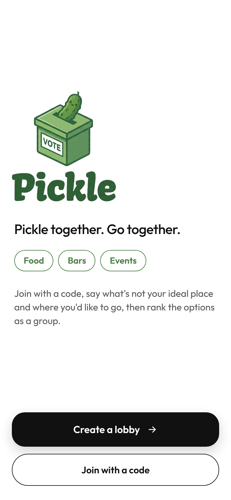
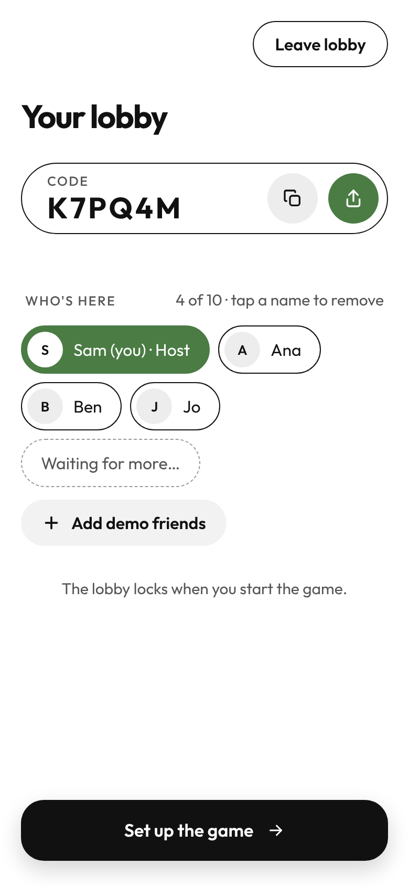
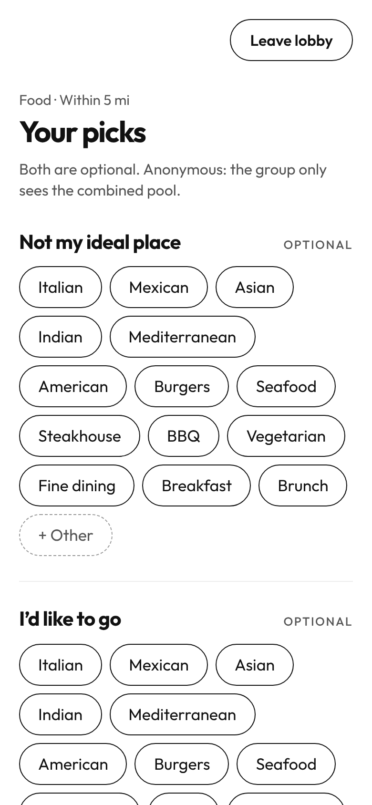
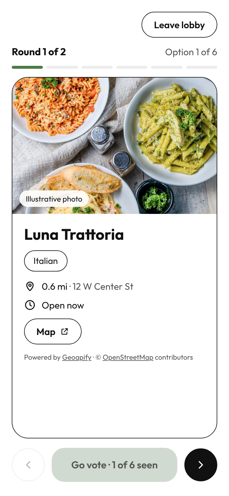
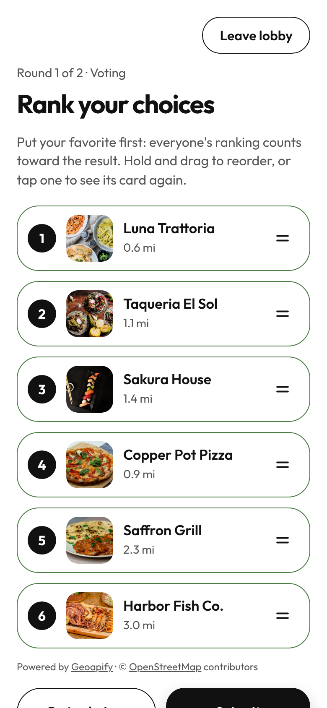
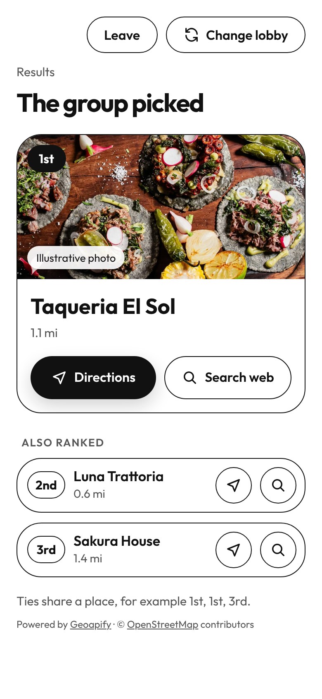

# Pickle

A mobile web app that helps a group of friends decide where to go — a restaurant, a bar or an event — in a few minutes. Everyone joins a lobby with a code, can pick a **No preference** ("Not my ideal place") and a **Yes preference** ("I’d like to go"), both optional, and Pickle finds real places nearby, scores them against the group's picks, and runs a quick ranked vote to a top 3. A No lowers a matching option's score rather than vetoing it; a Yes boosts it rather than guaranteeing a match. When the same preference appears on both sides, it cancels out.

Built as a portfolio project to show full-stack work end to end: real-time multiplayer state, a locked-down database, third-party API integration on free tiers, a tested scoring algorithm and a mobile-first design system.

<p>
  
  
  
  
  
  
</p>

**Status:** all 9 milestones built (Nov 2026). Screenshots are of the real app with made-up places (`node scripts/readme-screenshots.mjs`).

## How a game works

1. The host creates a lobby and shares its 6-character code; friends join with a name, no account needed.
2. The host picks Food, Bars or Events, a radius, and 1–3 rounds. Everyone privately picks one thing they'd rather avoid and one they'd like (both optional).
3. The server searches once, scores every place against the group's picks and distance, and shows 6 options as swipeable cards.
4. Everyone ranks the options; points decide each round. With more rounds, each round's top 2 go to a final vote.
5. Results show the winner and runners-up with directions (Apple or Google Maps) and a web search. The host can move everyone to a new lobby for the next game.

**Demo mode:** "Add demo friends" fills the lobby with simulated players who pick and vote a few seconds after you, and a demo lobby searches saved real data for Fayetteville, AR or Los Angeles, CA, so a whole game runs on one phone without spending API credits.

## What it demonstrates

| Area | How |
|---|---|
| Real-time multiplayer | Supabase Realtime pings and Presence keep every phone in sync within about a second; a 30-second check-in covers dropped connections |
| Database design and security | Postgres with forced row-level security and no browser access at all; every game rule is a SQL function only the server can call; 230+ SQL checks run on every change, and a read-only audit checks the live database |
| API integration on free tiers | Geoapify Places (OpenStreetMap data) and Ticketmaster behind a swappable provider interface; keys server-side only; a shared daily credit budget reserved atomically in Postgres before every call |
| Algorithms | Cancel-out rule for conflicting picks, tag matching, distance scoring, chain de-duplication, radius widening, ranked-vote tallies with tie-breaks, an OpenStreetMap opening-hours parser |
| Privacy | No accounts; only a name and a hashed device token are stored; the host's location is rounded, never shown and deleted after the search; everything is deleted after 24 hours by a scheduled job; a check fails the build if a log line could print an IP or key |
| Reliability | Requests time out and retry; a lost connection keeps the last screen with a notice; browser regression tests cover race conditions from pages Next.js keeps alive in the background |
| Frontend | Next.js 16 App Router PWA, a small design kit, screens built to a design spec, drag-to-rank with keyboard support |

## Architecture

```
Phone (Next.js PWA)
  │  our own API routes only, with an HTTP-only device cookie
  ▼
Vercel (Next.js server routes) ── Geoapify, Ticketmaster (keys stay here)
  │  secret key, server only
  ▼
Supabase Postgres (game rules as SQL functions, RLS on every table)
  │  "changed" pings with no data
  ▼
Supabase Realtime ──► every phone reloads its view from the server
```

Phones never read the database directly: each change sends a ping, and each phone asks the server for its own view of the lobby, which never includes anyone's picks, votes, scores or the host's location.

## Tech stack

| Part | Choice |
|---|---|
| Web app | Next.js 16 (App Router, TypeScript), installable as a PWA |
| Hosting | Vercel |
| Database and real-time | Supabase (Postgres, Realtime, Presence) |
| Places data | [Geoapify Places API](https://www.geoapify.com/places-api/) — free plan, OpenStreetMap data |
| Events data | [Ticketmaster Discovery API](https://developer.ticketmaster.com/) — free key |
| Tests | Vitest (app), plain Postgres 16 (database), both in GitHub Actions |

Every service runs on a free tier; no credit card is needed anywhere.

## Docs

- [Build order](docs/build-order.md): the order milestones are built in (start here)
- [Build plan](docs/build-plan.md): architecture, data model, API usage, security and each milestone's tests
- [Product spec](docs/product-spec.md): what the app does and how it looks
- [Screen designs](docs/screens/README.md) and [database setup](supabase/README.md)
- [Security and privacy checklist](docs/security-checklist.md) and [free-plan limits](docs/free-plan-limits.md)

## Run it locally

Needs Node.js 20.9 or newer.

```bash
npm install
```

```bash
npm run dev
```

Then open http://localhost:3000. The design kit preview is at http://localhost:3000/kit.

To create and join lobbies you need the settings below in a `.env.local` file (copy `.env.example`). Never commit `.env.local`.

## Settings and keys

Set these in Vercel (**Project → Settings → Environment Variables**, for Production and Preview) and in `.env.local` for local development. Anything secret is type **Secret** in Vercel and never starts with `NEXT_PUBLIC_` (the build stops if one does).

| Variable | Secret? | Where to get it |
|---|---|---|
| `NEXT_PUBLIC_SUPABASE_URL` | No | Supabase → Project Settings → API |
| `NEXT_PUBLIC_SUPABASE_PUBLISHABLE_KEY` | No (designed to be public) | Supabase → Project Settings → API Keys (`sb_publishable_…`) |
| `SUPABASE_SECRET_KEY` | **Yes** | Supabase → Project Settings → API Keys (`sb_secret_…`) |
| `GEOAPIFY_API_KEY` | **Yes** | Sign up free at [myprojects.geoapify.com](https://myprojects.geoapify.com), create a project, copy its API key. No credit card; the free plan allows 3,000 credits a day |
| `TICKETMASTER_API_KEY` | **Yes** | Sign up free at [developer.ticketmaster.com](https://developer.ticketmaster.com), open your app, copy the **Consumer Key** (not the Consumer Secret) |

**Database:** run each file in `supabase/migrations/` once, in order, in Supabase's SQL Editor. See [supabase/README.md](supabase/README.md).

## Scripts

| Command | What it does |
|---|---|
| `npm run dev` | Start the app for development |
| `npm run build` | Production build (what Vercel runs) |
| `npm test` | Unit tests (scoring, tags, images, API boundary, rate limits) |
| `npm run lint` | Check code style |
| `npm run typecheck` | Check TypeScript types |
| `npm run check:bundle` | After a build: fail if any key name, key value or API address is in the browser code |
| `npm run check:logs` | Fail if any log line could print an IP address, key, location or member data |
| `npm run check:browser` | After a build: browser regression tests with every API answer mocked |
| `npm run check:all` | Every check, in CI order |
| `npm run measure:slow` | After a build: page load times on Slow 3G and Fast 3G |
| `npm run check:secrets` | The pre-commit secret check (runs automatically on every commit) |
| `npm run images` | Resize the cuisine photos in `assets/restaurant-originals/` into `public/images/restaurants/` |
| `npm run logos` | Remake every logo and icon from `public/logo/pickle-logo.png` |

The SQL tests run on any Postgres 16; see [supabase/README.md](supabase/README.md).

## Security basics

- Secret keys live only in Vercel's environment settings and `.env.local`, are read through `src/lib/server-env.ts` (which can't be imported into browser code), and never use the `NEXT_PUBLIC_` prefix.
- Phones only talk to Pickle's own server routes and to Supabase Realtime; only the server calls Geoapify and Ticketmaster.
- Every commit runs a secret check (`.husky/pre-commit`), GitHub Actions runs [gitleaks](https://github.com/gitleaks/gitleaks), and `npm run check:bundle` runs after every CI build.
- Security headers (content security policy, no framing, strict referrer policy, location limited to this site) are set in `next.config.ts`.

## Data and image credits

- Restaurant and bar data: © [OpenStreetMap](https://www.openstreetmap.org/copyright) contributors, via [Geoapify](https://www.geoapify.com/). Event data: Ticketmaster.
- Restaurant and bar images are **illustrative** free stock photos (never the actual place), credited in [public/images/restaurants/CREDITS.md](public/images/restaurants/CREDITS.md).
