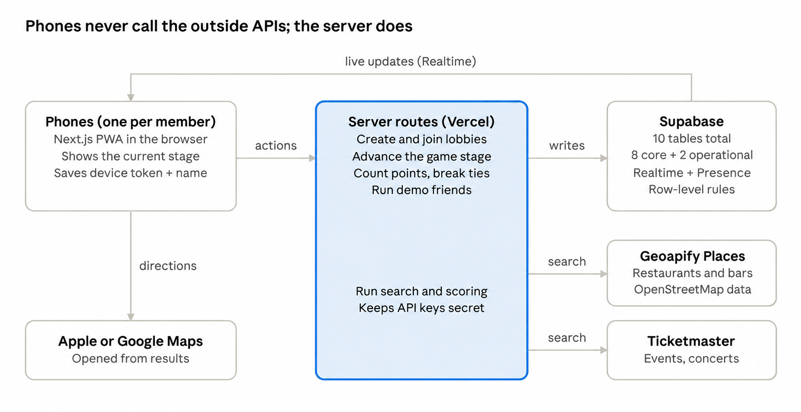

# Pickle MVP Build Plan

Nov 4, 2026 · @Santiago Perez Alferez

This plan turns the [Pickle MVP Product Spec](https://claude.ai/artifact/4oRMc4wEYKKGZwJzTFWMWE) into 9 milestones you can build and test one at a time, using the screens on the [Pickle screens canvas](https://claude.ai/artifact/TdTMjkpAfcNUVMX1JjMkMF).

## Architecture

Phones only show screens and send actions; server routes on Vercel do the work, store it in Supabase, and Supabase pushes changes back to every phone.

architecture · 6 parts

Geoapify Places (restaurants and bars, from OpenStreetMap data) and Ticketmaster (events) are called only by the server, so API keys and request limits stay under control.

## Data model

Ten public tables in Supabase (Postgres) hold the current data model: eight core gameplay tables and two operational tables. The core tables are listed below. No user accounts: a member is identified by a random token saved in their browser, plus the name they typed. The database stores only a hash of the token (`members.device_token_hash`), plus `members.left_at` for members who left on their own.

| Table         | What it holds                                                                                                                                              | Key fields                                                                                                                                                                                                  |
|---------------|------------------------------------------------------------------------------------------------------------------------------------------------------------|-------------------------------------------------------------------------------------------------------------------------------------------------------------------------------------------------------------|
| lobbies       | One row per lobby code (plus current_game_id, the game in progress)                                                                                                                                     | code (6 characters), status (open, locked, ended), host_member_id, is_demo, next_lobby_id, expires_at (24 hours)                                                                                            |
| members       | People in a lobby                                                                                                                                          | lobby_id, name (with number suffix for duplicates), device_token_hash, joined_at (sets host order), is_demo, removed_at, left_at, last_seen_at                                                                            |
| games         | One game inside a lobby                                                                                                                                    | lobby_id, category, event_date, radius_mi, age, indoor_outdoor, rounds_total, current_round, stage, center_lat, center_lng                                                                                  |
| picks         | Each member's Yes and No                                                                                                                                   | game_id, member_id, no_tag, no_other, yes_tag (optional), yes_other: a tag key, or "other" plus the typed text                                                                                                                                                  |
| options       | Every place or event found during the game, shown or not (the game's search cache), deleted with the game. | game_id, shown_in_round (empty until shown), source (geoapify or ticketmaster), source_id, name, normalized_name, address, tags, image (a local cuisine image key, or the event's Ticketmaster image), start time (events), distance_mi, link, score (never shown) |
| card_views    | Which cards a member has seen                                                                                                                              | member_id, option_id; used to unlock Go vote                                                                                                                                                                |
| votes         | One ranking per member per round                                                                                                                           | game_id, round_no (0 = final), member_id, ranking (ordered option ids), submitted_at                                                                                                                        |
| round_results | Points and who advanced                                                                                                                                    | game_id, round_no, option_id, points, first_place_votes, place, advanced                                                                                                                                    |

The two operational tables support abuse prevention and provider budgets:

| Table | What it holds | Key fields |
|---|---|---|
| rate_limits | Device-keyed rate-limit counters, created with the core schema in milestone 2; no IP addresses are stored here. | bucket, hits, reset_at |
| api_usage | Daily provider usage counters, added with live search in milestone 4; no locations, keys or request URLs are stored here. | day, provider, units, calls, refused |

All ten tables have row-level security enabled and forced, with no browser-role table grants. The game's **stage** drives every screen: picks → searching → cards_and_voting → round_complete → final_vote → results. Each phone shows the screen for the current stage; within cards_and_voting, each member moves from cards to voting at their own pace.

## Real-time lobby

Every phone subscribes to its lobby through Supabase Realtime, so joins, picks and votes appear on all screens within about a second, without refreshing.

- **What phones listen to:** an empty "changed" ping on a Realtime broadcast channel named after the lobby's random id, sent by a database trigger whenever the lobby or its members change. The ping carries no data; the phone then asks the server for the lobby as it should see it (and checks in every 30 seconds in case a ping is missed). Phones never read tables directly and never receive other members' picks or rankings, which keeps picks anonymous. *(Decided in milestone 2.)* Phones reload at most once every 2 seconds from pings, so fake pings on the channel can't flood them into their rate limits.

- **Who moves the game forward:** the server, not the phones. When the last pick or vote arrives, a server route advances the stage (for example voting → round_complete) and every phone follows. Anyone who taps "Change my picks" (or changes a submitted ranking) stops counting as done until they submit again, so the game never moves on while someone is still changing their mind.

- **Cards and voting:** each member moves through cards and voting at their own pace. The round ends when every active member has submitted a ranking, or the host removes someone who is stuck.

- **Online status:** Supabase Presence shows who is connected. A dropped phone reconnects with its saved token and lands on the current stage with its progress intact. A name alone never reclaims a spot: only the phone holding that spot's device token can (decided Nov 10, 2026).

- **Host handover:** if the host leaves or is removed, the server makes the earliest-joined active member the host and sends the "You're now the host" notice.

- **Security:** phones can't read or write any table. Every action (join, pick, vote) goes through a server route that checks the device token, the stage and the input, then writes with the secret key. *(Decided in milestone 2: stricter than per-member database rules, and it keeps the device token out of page scripts.)*

## Search and scoring

A server route fills each round, calling the APIs only when saved results can't, so API keys never reach the phones. It returns up to 6 options, each with a hidden score from 0 to 100.

1.  **Combine picks.** Collect every Yes and No. Drop any tag that is both someone's Yes and someone else's No.

2.  **Search.** First use places already found earlier in this game; call the APIs only if those can't fill the round. Food and bars: one **Geoapify Places** search around the host's location, within the radius, for the category's place types (restaurants or bars). Events: Ticketmaster search by location, radius and the chosen date.

3.  **Filter.** Drop places whose OpenStreetMap opening hours say they're closed now (places without hours are kept: the data is often missing), keep events on the chosen date, and 21+ venues only when the host allowed them. Remove anything already shown earlier in this game.

4.  **Remove duplicates.** Normalize names (lowercase, no punctuation or location suffix) and keep the closest location of each chain.

5.  **Score.** Start every option at 50, then apply the adjustments below.

6.  **Pick 6.** Keep options at or above the threshold (60, kept after real searches in Austin and New York), highest first. Fewer than 6: widen the radius by 5 mi once and search again; places already found are recognized by their source ID and skipped, never scored twice. Geoapify returns the nearest places first, so when the first search came back full (100 places) the widened search fetches the next 100 instead of the same ones. Still fewer: use what was found. None: tell the host.

7.  **No separate details calls.** The search itself returns everything a card needs (name, address, location, categories, cuisine, opening hours and website when OpenStreetMap has them). Each place gets a local cuisine image (see Cuisine images); no image is fetched from any API. Every result from every search is saved to the options table, so later rounds draw from it before calling the APIs again.

**Starting score adjustments** (to be tuned with real searches)

| Signal                                | Adjustment |
|---------------------------------------|------------|
| Each Yes that matches a primary tag   | +15        |
| Each Yes that matches a secondary tag | +8         |
| Each No that matches a primary tag    | −40        |
| Each No that matches a secondary tag  | −10        |
| Indoor/outdoor preference matches     | +5         |
| Distance (closest = full points)      | up to +20  |

No ratings or review counts are used: the places data (OpenStreetMap) has none, and events have none either. Distance is worth up to 20 points instead, so a place halfway across the radius with no Yes or No match still reaches the threshold of 60. *(Decided Nov 10–11, 2026.)*

Primary and secondary tags come from each source's own categories: for places, the OpenStreetMap cuisine (for example `cuisine=italian`, reported by Geoapify as `catering.restaurant.italian`) or bar type versus the place's other categories; for Ticketmaster, the event's genre versus its subgenre.

### Places data provider

*(Decided Nov 11, 2026: Geoapify replaces Google Places so the project runs free, for a portfolio and public demos.)*

- **Geoapify Places API** returns real nearby restaurants and bars from OpenStreetMap: name, address, coordinates, categories, cuisine, and, when mapped, opening hours, website and outdoor seating. No ratings, reviews or photos.
- **Free plan:** 3,000 credits a day. A Places request costs **1 credit per 20 places returned** (Places API docs, checked Nov 11, 2026), so Pickle's search for the nearest 100 places costs 5 credits, and a widened search another 5. There are no retries, so a failed request is never paid twice.
- **Checked against the live API (Nov 11, 2026):** categories are `catering.restaurant` for food and `catering.bar`, `catering.pub`, `catering.biergarten`, `catering.taproom` and `adult.nightclub` for bars. Each result has Geoapify categories (like `catering.restaurant.italian`) and the raw OpenStreetMap tags in `datasource.raw` (`cuisine`, `opening_hours`, `outdoor_seating`, `min_age`, `diet:*`, `live_music`, `sport`), plus the distance in meters from the search center. In samples from Austin and New York about 60% of restaurants had a cuisine and about 40% had opening hours; bars rarely have more than their type. The key is sent in the `x-api-key` header, so it never appears in a URL or log.
- **Caching:** Geoapify's docs say Places results may be cached and stored with no limits; the game cache keeps them only for the game.
- **Swappable provider.** All provider code sits behind one interface (`PlacesProvider`: search(center, radius, category) → list of `Candidate`s). Scoring, picks, voting and results only ever see `Candidate`s, so changing provider later means writing one new adapter, not touching the game.
- **Attribution:** every screen showing place data shows "Powered by Geoapify" and "© OpenStreetMap contributors", with links. Geoapify's terms (checked Nov 11, 2026): OpenStreetMap attribution is always required, and Geoapify attribution is required on the free plan.

### Cuisine images

- Cards and results show a **cuisine image** chosen from a small local library in `public/images/restaurants/` (for example `italian.jpg`, `mexican.jpg`, `bar.jpg`), matched by the place's cuisine or bar type, with `restaurant-default.jpg` / `bar-default.jpg` when nothing matches.
- Images are free stock photos whose licenses allow this use (Unsplash or Pexels), resized and compressed locally. Each one's source, author and license is recorded in `public/images/restaurants/CREDITS.md`.
- Every card says the image is illustrative ("Illustrative photo") so nobody mistakes it for the actual restaurant.
- No image is ever requested from a places API. Events keep the image Ticketmaster includes in its event data, at no extra cost.

## API cost

Everything runs on free tiers: Geoapify's free plan (3,000 credits a day) and Ticketmaster's free key (5,000 calls a day). The goal is about one places search per game and no repeated work. These rules are built into milestones 4 and 5 from the start.

1.  **One places search per game where possible.** One Geoapify request returns up to 100 raw places. All valid candidates are scored, and the rest are saved for later rounds, so a multi-round game usually runs on one search. A second search happens only when a round comes up short (the 5 mi widening); its offset counts raw results, including records skipped by the parser.

2.  **No image requests.** Cards use the local cuisine images, so showing cards costs nothing (see Cuisine images).

3.  **Never repeat work within a game.** Saved results are used first, and a wider search skips places already found (see Search and scoring).

4.  **Saved data for demos and testing.** Explicit demo lobbies and automated tests use saved samples without spending provider credits. Demo results are labeled as samples, not live nearby recommendations. Non-demo development sessions still use the configured providers.

5.  **Ticketmaster in one batch.** A default key is free, limited to 5,000 calls a day and 5 a second. ([Ticketmaster docs](https://developer.ticketmaster.com/products-and-docs/apis/getting-started/)) One call fetches a large batch of events for the whole game.

6.  **Hard limits and logging (built in milestone 4).** At most 2 searches per round. A shared daily budget in Postgres (`api_usage`, one row per day and provider) is reserved atomically before every request: 2,500 Geoapify credits and 4,500 Ticketmaster calls a day, below the free plans, across every Vercel instance. When the budget is used up, the search stops and the host sees the nothing-found screen with a "try again later" note. The same table is the call log: credits, calls and refused calls per day, with no locations, keys or URLs. Only one server runs a round's search (claimed in the database), so phones refreshing during the search never cause extra calls. Changing the criteria (which starts a new search) is rate limited to 10 an hour per device. Errors are logged as a short label only, never a request URL, a provider's error body or a location.

OpenStreetMap data is open (ODbL): it may be stored with attribution, so the game cache keeps it for the length of the game. It is still deleted with the game, as the privacy rules require.

## Security and privacy

Secret keys live only on the server, every database table is locked down by default, and the app stores as little about people as it can: a name, a random device token and nothing else. These rules apply from milestone 1, not as a final clean-up.

**API keys (backend only)**

- The Geoapify key, the Ticketmaster key and the Supabase secret key (called the service_role key in Supabase's older key system) are stored only in Vercel's server environment settings. None of them uses the NEXT_PUBLIC\_ prefix, because Next.js sends any variable with that prefix to the browser.

- Only server routes call Geoapify and Ticketmaster. Phones call our own routes, so no outside API URL or key ever appears in the browser's network traffic.

- Phones never load images from a places API: cuisine images are files on our own site, and event images come from Ticketmaster's image servers (which need no key).

- The Geoapify key is read only by server code through `src/lib/server-env.ts` (`serverSecret("GEOAPIFY_API_KEY")`), which can't be imported into browser code, and the build stops if the key is ever given the NEXT_PUBLIC_ prefix.

- Geoapify's free plan has no billing attached, so a leaked key can't cost money; at worst it uses up the day's free credits. Geoapify lets you limit a key to certain sites or IP addresses, but Vercel has no fixed IPs, so the key stays unrestricted there and is rotated in Geoapify's dashboard if it ever leaks.

- Separate keys for development and production. If a key ever leaks, rotate it in that service's console the same day.

**Database**

- Row-level security is turned on for every Supabase table, with no policies at all, and the browser roles have no grants, so the publishable key can read and write nothing. Only server routes, using the secret key, touch the tables.

- The Supabase publishable key (formerly the anon key) is designed to be visible in the browser; the row-level rules are what protect the data. The secret key bypasses those rules, so it stays on the server. Use Supabase's new publishable and secret keys from the start, since the older keys are being deprecated.

- The server decides everything that matters: stage changes, scores, points and winners. Phones can't skip ahead or submit a vote for someone else.

- Every server route checks its input: name length and characters, a valid lobby code, tags from the allowed list, and rankings containing only that round's options.

**People's data and IP addresses**

- Collected: a display name, a random device token, picks and votes. Not collected: email, phone number, accounts, or contacts.

- IP addresses are never written to the database. They are used only in memory for rate limiting, and the app's own log messages never include them. Vercel keeps its runtime logs only briefly (1 hour on the free Hobby plan, 1 day on Pro).

- Members never see each other's IP addresses: every update travels through Supabase, never directly between phones.

- The host's location is used only to center the search, is stored rounded to about 100 m, is never shown to other members (they see distances only), and is deleted as soon as the game's last search is done: after round 1's search in a 1-round game, after the last round's search otherwise, after any search that found nothing (changing the criteria sends a fresh one), and at the latest when the game ends (built in milestone 4, decided Nov 10–11, 2026). Ending the game deletes the game and everything in it. The host's phone also sends its time zone, used only to tell whether places are open now.

- A daily cleanup job deletes lobbies, members, picks, votes and saved places more than 24 hours old.

- No ad trackers or third-party analytics. If analytics are added later, use a privacy-focused tool that doesn't store IP addresses.

**Website**

- HTTPS only (Vercel's default), plus security headers: a content security policy, no embedding in other sites' frames, a strict referrer policy, and location permission limited to the app itself.

- Rate limits on every server route, keyed by device and IP: for example, lobby creation, join attempts (to stop people guessing codes) and searches.

- Lobby codes are random, use 6 characters without look-alikes (no 0/O or 1/I), and expire after the game or 24 hours.

- The device token is a long random value kept in a secure, HTTP-only cookie, so page scripts can't read it.

- React escapes names and text by default; the app never inserts raw HTML from users or outside APIs.

**Accounts and code**

- Two-factor sign-in on GitHub, Vercel, Supabase, Geoapify and Ticketmaster.

- .env files are in .gitignore, and a pre-commit secret check (such as gitleaks) blocks commits that contain a key. GitHub's own secret scanning is free on public repositories; on a private repository it may require GitHub's paid Secret Protection.

- Dependabot alerts on, and npm audit checked at every milestone.

Before any public launch, add a short privacy policy (the app uses location) and get a security review from someone besides Claude.

## Build milestones

Each milestone ends with something you can try on your phone. Search uses sample data until milestone 4, so the flow can be tested before the API keys are ready.

1.  **Project setup and design kit**

    - Next.js app set up as a PWA, deployed to Vercel, with the Outfit font and the 2F pieces: main button, pill buttons, chips, code bar, member chips. Security headers, server-only environment settings, the pre-commit secret check and two-factor sign-in on every account. App name "Pickle" in the browser tab and home-screen label. Logo files made from public/logo/pickle-logo.png, the owner's transparent PNG (with its empty margins trimmed), with the browser tab icon, the 180, 192 and 512 px home-screen icons and the link preview image made only by resizing and cropping that file, never redrawing it (see Logo in the product spec).

    - Test: open the link on your phone and add it to your home screen; check the Pickle icon and name appear, the icon isn't cut off on Android, and the logo shows on the home screen with no checkerboard or white box around it.

2.  **Lobby and joining** (screens 01–06, 18, 19)

    - Create a lobby with a code, join with a name, live member chips, duplicate names, leave, remove, host handover, rejoin with the same name. Row-level security on every table, the device-token cookie, input checks and rate limits on create and join.

    - Test: 3 phones join one lobby; close and reopen one; remove one; try 20 wrong codes in a row and confirm you get blocked.

3.  **Host setup and picks** (screens 07–09)

    - Setup options, Yes/No tag picker, waiting screen, cancel-out rule. The lobby locks when the game starts.

    - Test: everyone picks; only who's done is visible, never what they chose.

4.  **Search with real data** (screens 10–11)

    - Geoapify Places (behind the swappable `PlacesProvider` interface) and Ticketmaster, filters, duplicate removal, scoring, widening by 5 mi, nothing-found screen, deleting the host's location after the last search, and the API cost rules 1, 3, 5 and 6 (one search per game, game cache, batched events, daily cap and call log). Confirm Geoapify's category names, credits per request and attribution wording against the live API.

    - Test: food, bars and events at different radii; check the 6 options make sense and the call log shows about one places search per game. Search the browser's page source and network traffic for the API keys and confirm they never appear.

5.  **Option cards** (screen 12)

    - Card with the cuisine image (labelled "Illustrative photo") or the event's Ticketmaster image, name, cuisine or type, distance, address, "Open now" when known, and a link (the place's website or a map link; the ticket page for events); arrows and swiping; Go vote unlocks after every card is seen. Cards with place data show "Powered by Geoapify · © OpenStreetMap contributors". The cuisine image library and its credits file are added here.

    - Built Nov 11, 2026: each phone remembers which cards it has seen this round (browser storage, so a reload keeps progress). Places without a website get a map search link built from their public name and address. Until milestone 6, Go vote opens a "Ranking is next" placeholder with Go to choices.

    - Test: try to vote before seeing all cards.
    - **Pickle green** (decided Nov 11, widened Nov 12, 2026): a `--pickle` color in the design kit, \#4A7C44 (lighter than the first choice, \#2F5E36; white text on it is 4.9:1). Used for the selected pills (Yes / No picks, setup options), the host's member chip, the share buttons, the done chips on the waiting screen, the check marks on the searching screen, the Go vote button once it unlocks, the outline and text of the home screen's Food / Bars / Events pills, and the outline of the ranking you're ordering (screens 13 and 15). The cards themselves stay black and white.

6.  **Voting and rounds** (screens 13–15)

    - Drag to rank, points, tie-breaks, round complete, 2–3 rounds with all-new options, final vote.
    - **Changing a ranking un-readies you** (same rule as picks, decided Nov 10, 2026): going back from Submit to change a ranking takes you out of "done" on the server until you submit again, so the round can't end while someone is still changing their ranking. Done in one locked database step, so a last submit and a change can't race.

    - Test: a 2-round game with 3 people, including a forced tie.
    - **Pickle green outline** (decided Nov 11, 2026): the ranking list you're ordering (screens 13 and 15) uses the same green, \#4A7C44 (`--pickle`), for its outline, instead of black.

7.  **Results and replay** (screens 16–17)

    - Top 3, directions in Apple or Google Maps, web search link, Change lobby moving everyone to a new code. Results with place data show the same Geoapify / OpenStreetMap attribution as the cards.

    - Test: full game end to end, then start a second game.

8.  **Demo mode**

    - Add demo friends button; simulated members pick and vote a few seconds after you. Record the saved sample search (food, bars and events) at your real demo location, so demo games show local places without calling the APIs.

    - Test: run a whole game alone on one phone.

9.  **Polish and demo prep**

    - Loading and error states, join errors (screen 04), spending caps checked, speed on a slow connection. Daily cleanup job, a check that no log message contains IP addresses or keys, and a pass through the Security and privacy checklist.

    - Test: a real game with friends, then rehearse the demo.

## Accounts and keys

You create these accounts yourself; set aside 30–60 minutes. Only the first three are needed to start; the API keys can wait until milestone 4.

| Account                | Used for                                            | Needed by       | Notes                                                                        |
|------------------------|-----------------------------------------------------|-----------------|------------------------------------------------------------------------------|
| GitHub                 | Storing the code                                    | Milestone 1     | Free                                                                         |
| Vercel                 | Hosting the website                                 | Milestone 1     | Free tier; connect it to the GitHub repo                                     |
| Supabase               | Database, real-time lobbies                         | Milestone 2     | Free tier                                                                    |
| Geoapify               | Places API key (restaurants, bars)                  | Milestone 4     | Free plan, no credit card: 3,000 credits a day                               |
| Ticketmaster Developer | Events API key                                      | Milestone 4     | Free developer key; 5,000 calls a day, 5 a second                            |
| Domain name (optional) | A short link for Pickle (pick one that's available) | Before the demo | Any registrar; Vercel connects it                                            |

Keys go into Vercel's environment settings, never into the code or a chat message.

## How we work

Claude writes the code one milestone at a time; you review it and test it on your phone before the next one starts.

1.  Connect the GitHub repo so Claude can work in it (Claude Code works directly in the repo).

2.  Start each milestone by pointing Claude at the copies of this plan and the product spec in the project folder, and at the screen images the milestone covers (see Project folder setup below).

3.  Claude builds it on its own branch and opens a pull request with a short summary and a test checklist.

4.  Vercel creates a preview link for every pull request. Test on your phone using the milestone's test step.

5.  Report anything that looks or works wrong; Claude fixes it on the same branch.

6.  When it passes, merge the pull request and move to the next milestone.

Keep the spec current: if a decision changes during the build, update the product spec first so later milestones follow it.

**Project folder setup (before milestone 1)**

Claude Code works from files in the project folder and usually can't open private claude.ai links, so put copies of everything it needs there:

| File                        | What it is                                                     |
|-----------------------------|----------------------------------------------------------------|
| docs/product-spec.md        | This product spec, exported as Markdown                        |
| docs/build-plan.md          | This build plan, exported as Markdown                          |
| docs/screens/               | One image per screen (01–19), exported from the screens canvas |
| public/logo/pickle-logo.png | The original transparent logo PNG                              |

The Markdown export replaces the two diagrams (game flow and architecture) with placeholders; the text around them describes the same thing. If a decision changes, update the claude.ai doc first, then re-export it into the folder.

## Risks to watch

| Risk                                                                    | What to do                                                                                                                                          |
|-------------------------------------------------------------------------|-----------------------------------------------------------------------------------------------------------------------------------------------------|
| Running out of Geoapify's free daily credits                            | One search per game, game cache, our own daily cap at about 2,500 credits, and demo mode on saved data                                                |
| Thin results in small towns or on quiet nights                          | The 5 mi widening and the nothing-found screen cover this; test at your real demo location                                                          |
| OpenStreetMap data is incomplete (hours, cuisine, outdoor seating, 21+) | Keep places with unknown hours; default cuisine image when the cuisine is missing; treat age and indoor/outdoor as best effort, as the spec says      |
| A phone drops mid-game                                                  | Rejoin with the saved token and name; the host can remove someone who is stuck                                                                      |
| Demo-day surprises (bad signal, API outage)                             | Demo mode plus a saved sample search let the demo run even if a live search fails                                                                   |
| Missing data attribution or image credits                               | Show "Powered by Geoapify · © OpenStreetMap contributors" wherever place data appears; keep CREDITS.md for every cuisine image                     |
| The name Pickle is already used by another app or company               | Fine for a demo; before a public launch, run a trademark search and check the app stores and domains                                                |
