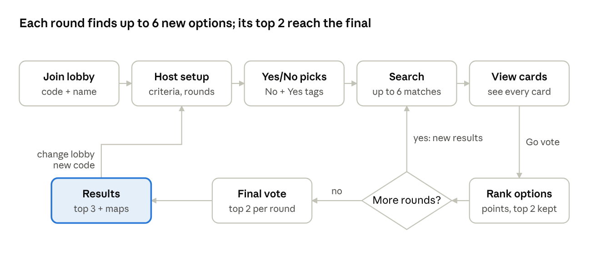

# Pickle MVP Product Spec

Nov 4, 2026 · @Santiago Perez Alferez

## Overview

Pickle helps a group of up to 10 friends agree on a plan (a restaurant, bar or event) in a few minutes. Members join a lobby with a code, each submits one required No preference and an optional Yes preference, then everyone browses up to 6 matched options and ranks them. No preferences lower scores rather than vetoing an option; Yes preferences boost scores rather than guaranteeing a match. Conflicting Yes and No preferences cancel out as described below.

- **Platform:** mobile-first website (PWA), no install. Can be wrapped as a native app later.

- **MVP goal:** a polished demo for investors, a class or a portfolio.

- **MVP categories:** food, bars, and events/concerts.

- **Build approach:** Claude writes most of the code; the owner reviews and tests it.

## Game flow

A game runs 1 to 3 rounds of search, cards and ranking, and always ends with a top 3.

game flow · 9 steps, 1 decision, 2 loops

A 1-round game skips the final vote and goes straight to results. Change lobby starts a new game with new criteria and a new lobby code.

## Lobby rules

One lobby code lasts for one full game (all rounds plus the final vote). When the game ends, the code is retired and everyone is moved to a new lobby with a new code automatically.

- **Joining:** enter the code, then a name. No other information is required.

- **Group size:** up to 10 members, including the host.

- **Duplicate names:** a number is added (Sam, Sam 2).

- **Locking:** the lobby closes when the host starts the game, before voting begins. Latecomers can only join between full games, using the new code.

- **Disconnects:** a member who drops out gets their spot and progress back on the same phone and browser, automatically or by entering the code again. A name is never proof of who someone is: a different phone using a taken name joins as a new member ("Sam 2"), and the host can remove the old spot. *(Decided Nov 10, 2026, after a security review: otherwise anyone could take over the host by typing their name.)*

- **Host leaves:** the host role passes automatically to the member who joined earliest.

- **Removing members:** the host can remove a member from the lobby.

- **Timers:** none. The group waits until everyone has finished each step.

## Host setup

The host sets the game's criteria before members make their picks; every round in the game uses them. The search is centered on the host's current location.

| Setting        | Options                        | Default         |
|----------------|--------------------------------|-----------------|
| Category       | Food, Bars, Events/Concerts    | none (required) |
| Date           | Events only: dropdown of dates | Today           |
| Radius         | 1, 5, 10, 25, 50 mi            | 5 mi            |
| Age            | All ages, 21+                  | All ages        |
| Indoor/outdoor | Indoor, Outdoor, Either        | Either          |
| Rounds         | 1, 2, 3                        | 1               |

Food and bars skip places that OpenStreetMap lists as closed right now; places without listed hours are kept, because hours are often missing. Cards say "Open now" when the hours are known. Indoor/outdoor is a preference, not a strict filter, because the data is incomplete (see Data limits).

## Yes / No picks

Each member must pick one No preference and may also pick one Yes preference. "Required" describes submitting a No, not a guarantee that matching options will be excluded. Picks come from preset tags for the chosen category, with an optional "other" field. Picks are anonymous; the group only sees the combined pool.

**Rules**

1.  **Yes = boost.** Options matching more Yes picks score higher.

2.  **No = scaled penalty, never a veto.** The penalty depends on how central the tag is to the option.

    - Primary tag (a country-only concert vs. a No on country): heavy penalty.

    - Secondary tag (a country-pop artist vs. a No on country): light penalty.

3.  **Cancel-out.** If one member's Yes and another member's No are the same tag, both are dropped and neither counts.

**Tags** (final, decided Nov 9, 2026)

Each tag maps to categories the data sources return, so picks change the scores. A tag is a **primary** match when it matches a place's main type or an event's genre, and a **secondary** match when it matches another type or the subgenre (see rule 2). Places tags match OpenStreetMap data, which Geoapify returns: the `cuisine` value (like `italian`, shown by Geoapify as the category `catering.restaurant.italian`) or the bar type. Checked against Geoapify's live data on Nov 11, 2026 (milestone 4). A tag's words in a place's name or description also count as a secondary match, because much OpenStreetMap data has no cuisine ("Little Italy Pizza" counts for Italian). Tags marked *best effort* have no dedicated OpenStreetMap category and match by keyword or optional tag, so they'll miss some places.

| Category | Tag | Matches |
|---|---|---|
| Food | Italian | OSM cuisine: italian, pizza |
| Food | Mexican | OSM cuisine: mexican, tex-mex, tacos |
| Food | Asian | OSM cuisine: chinese, japanese, thai, korean, vietnamese, asian, ramen, noodle, sushi, dumpling, taiwanese, filipino, indonesian, malaysian |
| Food | Indian | OSM cuisine: indian |
| Food | Mediterranean | OSM cuisine: mediterranean, greek, lebanese, turkish, middle_eastern, arab, persian, moroccan, syrian |
| Food | American | OSM cuisine: american, diner, texan, cajun, southern |
| Food | Burgers | OSM cuisine: burger |
| Food | Seafood | OSM cuisine: seafood, fish, fish_and_chips |
| Food | Steakhouse | OSM cuisine: steak_house |
| Food | BBQ | OSM cuisine: barbecue, bbq |
| Food | Vegetarian | OSM cuisine: vegetarian, vegan; also places tagged `diet:vegetarian` or `diet:vegan` = yes/only (secondary; "no" never matches) |
| Food | Fine dining | OSM cuisine: fine_dining (seen in live data), or keyword ("fine dining", "tasting menu"), best effort |
| Food | Breakfast | OSM cuisine: breakfast |
| Food | Brunch | OSM cuisine: brunch |
| Bars | Sports bar | Bars with an OSM `sport` tag, or keyword "sports", best effort |
| Bars | Cocktail bar | Keyword ("cocktail", "speakeasy", "mixology") in the name or description, best effort |
| Bars | Brewery | OSM beer garden (biergarten), taproom, microbrewery, or keyword "brewery"/"brewing"/"taproom" |
| Bars | Wine bar | Keyword "wine" or OSM wine tags, best effort |
| Bars | Pub | OSM pub |
| Bars | Club | OSM nightclub (Geoapify category `adult.nightclub`) |
| Bars | Karaoke | OSM karaoke venue or karaoke tag, best effort |
| Bars | Live music | OSM live-music tag, or keyword "live music", best effort |
| Bars | Lounge | Keyword "lounge", best effort |
| Bars | Rooftop | Keyword ("rooftop", "sky bar"), best effort |
| Events | Country | Ticketmaster genre: Country |
| Events | Pop | Ticketmaster genre: Pop |
| Events | Hip-hop | Ticketmaster genre: Hip-Hop/Rap |
| Events | Rock | Ticketmaster genres: Rock, Alternative, Metal |
| Events | EDM | Ticketmaster genre: Dance/Electronic |
| Events | R&B | Ticketmaster genre: R&B |
| Events | Latin | Ticketmaster genre: Latin |
| Events | Jazz | Ticketmaster genres: Jazz, Blues |
| Events | Comedy | Ticketmaster genre: Comedy |
| Events | Theater | Ticketmaster genres: Theatre, Musical |
| Events | Sports | Ticketmaster segment: Sports |
| Events | Family | Ticketmaster genre: Family |

The "+ Other" field is matched as a keyword against names and types: it counts, but less precisely than a tag. Age (21+) and indoor/outdoor are host settings, not tags.

## Search and matching

Each round aims for 6 options that score at or above the match threshold (about 60%, tuned during the build). The match score is never shown to members.

- **Sources:** the Geoapify Places API for restaurants and bars (real places from OpenStreetMap); the Ticketmaster API for events and concerts. Both are free. The places provider sits behind one interface, so it can be swapped later without changing the game.

- **Duplicates:** chains appear once, using the closest location. Results from different sources are merged by normalized name.

- **Match score:** combines Yes boosts, scaled No penalties, host criteria (age, indoor/outdoor) and distance. There are no star ratings or reviews: the places data has none.

- **Fewer than 6 matches:** widen the radius by 5 mi once. If there are still fewer than 6, the round uses only what was found. If nothing viable is found, the host is told and can change the criteria.

- **Later rounds:** same criteria, all-new results. No option repeats within a game. To stay within the free plans, every place found is saved for the whole game (and deleted with it): later rounds use saved results first, and a wider search never re-fetches a place already found. The full cost rules (one search per game, local images, daily caps) are in the [Pickle MVP Build Plan](https://claude.ai/artifact/7Cw68JuzPSG17P7eJqub6c).

## Cards, voting and rounds

Members must view every card (normally 6) before they can vote. Rankings are combined with points, and each round's top 2 move on to the final.

**Cards (view only)**

- Each card shows an image, the name, the cuisine or type of place (or the event's genre and start time), distance, the address, "Open now" when known, and a link: the place's website or a map link, or the event's ticket page. For restaurants and bars the image is an **illustrative cuisine photo** from Pickle's own library (labelled "Illustrative photo", never presented as the actual place); events show the image Ticketmaster provides. Cards with place data show "Powered by Geoapify · © OpenStreetMap contributors".

- Swiping or the arrow buttons only move between cards; they do not record likes.

- A **Go vote** button at the bottom unlocks after every card has been seen. On the voting screen it becomes **Go to choices**, so members can go back to the cards.

**Voting**

- Members drag the options into order, from 1st to last (6 options, or fewer if the search came up short). Only the voting screen has a **Submit** button.

- Points: 1st = 6, 2nd = 5, 3rd = 4, 4th = 3, 5th = 2, 6th = 1. With fewer options, 1st gets as many points as there are options. Each option's total is the sum across members.

- Ties for advancing are broken by the most 1st-place votes, then at random.

**Rounds**

- The host picks 1 to 3 rounds (default 1).

- With 1 round, its results are the final results.

- With 2 or 3 rounds, the top 2 of each round (4 or 6 options) go to a final vote, ranked the same way.

## Results and replay

The results screen shows the top 3 options in order, with no point totals or names.

- **Order:** by points, then most 1st-place votes. If two options are still tied, they share the place (1st, 1st, 3rd).

- **Directions:** opens Apple Maps on iPhone and Google Maps on Android.

- **Link:** opens a web search for the place or event.

- **Change lobby:** a button in the corner lets the group play again with new criteria. Everyone moves to a new lobby code automatically.

- **Nothing carries over:** a new game starts fresh, with no saved picks, history or excluded results.

## Privacy and security

Pickle keeps only what a game needs and deletes it within 24 hours; all API keys stay on the server.

- **What is stored:** a display name, a random device token, picks and votes. No email, phone number, account or contacts.

- **IP addresses:** never stored in the database; used only briefly to block abuse (for example, someone guessing lobby codes). Members never see each other's IP addresses.

- **Location:** the host's location only centers the search. Other members see distances, never the host's position. It is stored rounded to about 100 m and deleted as soon as the game's last search is done (at the latest when the game ends).

- **Retention:** places found for a game are deleted with the game; lobbies, members, picks and votes are deleted after 24 hours.

- **API keys:** the Geoapify key, the Ticketmaster key and the database secret key are used only by server code and never sent to phones.

- **Before public launch:** a short privacy policy and an outside security review.

The full technical rules are in the Security and privacy section of the [Pickle MVP Build Plan](https://claude.ai/artifact/7Cw68JuzPSG17P7eJqub6c).

## Screens

| \#  | Screen            | Who            | What happens                                                                                  |
|-----|-------------------|----------------|-----------------------------------------------------------------------------------------------|
| 01  | Home              | Everyone       | Pickle logo; create a lobby or join with a code                                               |
| 02  | Join: enter code  | Members        | 6-character lobby code                                                                        |
| 03  | Join: enter name  | Members        | Name only; same name to rejoin                                                                |
| 04  | Join: can't join  | Members        | Code not found, lobby full, game in progress, name taken                                      |
| 05  | Lobby (host)      | Host           | Code bar with copy and share, member chips, remove members, Add demo friends, Set up the game |
| 06  | Lobby (member)    | Members        | Waiting for the host, member chips, Leave lobby                                               |
| 07  | Host setup        | Host           | Category, date (events), radius, age, indoor/outdoor, rounds                                  |
| 08  | Yes / No picks    | Everyone       | One No and an optional Yes from tags                                                          |
| 09  | Waiting for picks | Everyone       | Who's done (not what they picked); change my picks                                            |
| 10  | Searching         | Everyone       | Search progress, including widening the radius                                                |
| 11  | Nothing found     | Host           | Nothing viable found; Change criteria or End game                                             |
| 12  | Cards             | Everyone       | Up to 6 option cards; Go vote unlocks after all are seen                                      |
| 13  | Rank options      | Everyone       | Drag to rank 1st to last; Go to choices; Submit                                               |
| 14  | Round complete    | Everyone       | Suggested: shows the top 2 that advance (multi-round games only)                              |
| 15  | Final vote        | Everyone       | Rank the 4 or 6 finalists                                                                     |
| 16  | Results           | Everyone       | Top 3, directions, web search link, Change lobby                                              |
| 17  | New lobby         | Everyone       | New code after a game; latecomers can join                                                    |
| 18  | Host left         | Everyone       | Notice that the host role moved to the member who joined earliest                             |
| 19  | Removed           | Removed member | Removed by the host; join another lobby                                                       |

## Design

The app uses a black-and-white "2F" style: pill-shaped chips and secondary buttons, one soft-cornered black main button per screen, and the Outfit font. All screens are on the [Pickle screens canvas](https://claude.ai/artifact/TdTMjkpAfcNUVMX1JjMkMF).

| Element           | Decision                                                                                                                                                                                                        |
|-------------------|-----------------------------------------------------------------------------------------------------------------------------------------------------------------------------------------------------------------|
| Colors            | Black \#111111 on white; grey \#555555 for secondary text; light grey \#EDEDED / \#F2F2F2 for fills and disabled states. One accent: **Pickle green \#4A7C44**, a lighter green matching the logo (white text on it is 4.9:1, above the 4.5:1 readability minimum), used for the selected pills (Yes / No picks, setup options), the host's member chip, the share buttons, the done chips on the waiting screen, the check marks on the searching screen, the card progress bars, the Go vote button (filling from grey to green as cards are seen), the outline and text of the home screen's Food / Bars / Events pills, and the outline of the ranking you're ordering (screens 13 and 15). Everything else, including the other main buttons, stays black and white; the logo keeps its own greens. |
| Logo              | The owner's Pickle logo file, used exactly as supplied (see Logo below)                                                                                                                                         |
| Font              | Outfit (Google Fonts): 700 for headings, 600 for buttons and names, 400 for body                                                                                                                                |
| Main button       | Black, 22px corners, soft shadow, one per screen, pinned near the bottom                                                                                                                                        |
| Secondary buttons | White with a black 1.5px outline, fully round (pill)                                                                                                                                                            |
| Chips and tags    | Pills; selected = solid black with white text                                                                                                                                                                   |
| Lobby code        | Outlined pill bar with round copy and share buttons                                                                                                                                                             |
| Members           | Pill chips with an initial; host chip in black                                                                                                                                                                  |
| Option card       | Contained card filling most of the screen; one image on top (cuisine photo with an "Illustrative photo" label, or the event image); details and a website, map or ticket link below |
| Ranking           | Drag to reorder; dragged row lifts with a shadow and a dashed drop slot                                                                                                                                         |
| Disabled states   | Light grey fill with grey text, plus a short reason ("3 of 6 seen")                                                                                                                                             |

**Logo**

The app uses the owner's Pickle logo (a green ballot box with a smiling pickle going into the slot, the word "Pickle" below). It is used exactly as supplied: never redrawn, regenerated, recolored or restyled.

- **Source file:** the owner's PNG logo, 2752 × 1536 px, checked and confirmed to have a truly transparent background, kept in the project at public/logo/pickle-logo.png. Its large empty margins are trimmed before use; the logo at the top of this spec is that trimmed copy. Never use a JPG copy, since JPG can't store transparency.

- **Two versions, both cut from that file:** the full logo (box and wordmark), and an icon version (box and pickle only) for small sizes where the wordmark can't be read.

- **Sizes are made by resizing and cropping the original file only.**

| Where                     | Version   | Notes                                                                                                                    |
|---------------------------|-----------|--------------------------------------------------------------------------------------------------------------------------|
| Home screen (01)          | Full logo | Replaces the placeholder and the typed app name; about 200 px wide                                                       |
| Browser tab icon          | Icon      | 32 px and 16 px                                                                                                          |
| Phone home-screen icon    | Icon      | 180 px (iPhone), 192 px and 512 px (Android), on a white square with padding so Android's rounded masks don't cut it off |
| Shared lobby link preview | Full logo | On a white image, shown when a lobby link is pasted into a chat                                                          |
| App name                  | Text      | "Pickle" in the browser tab title and under the home-screen icon                                                         |

- **Rules:** keep the original colors and proportions, no effects or outlines, clear space around it of at least the height of the pickle, and only on white backgrounds.

- **Alt text:** "Pickle logo".

## Data limits, tech stack and open items

**Data limits (agreed)**

- **21+:** reliable for ticketed events. For bars and clubs it is inferred from the venue type.

- **Indoor/outdoor:** for food and bars it uses OpenStreetMap's outdoor-seating tag where present (and places like beer gardens); little is known for events. Used as a preference, not a filter.

- **Event sources:** Ticketmaster only for the MVP. Search is built so more event sources can be added later without changing the rest of the app.

**Tech stack**

| Part              | Choice            | Why                                                     |
|-------------------|-------------------|---------------------------------------------------------|
| Web app           | Next.js (PWA)     | One codebase for phones and desktop                     |
| Real-time lobbies | Supabase          | Live member lists, picks and votes                      |
| Hosting           | Vercel            | Simple deploys, free tier                               |
| Places data       | Geoapify Places API (OpenStreetMap data) | Restaurants and bars; free plan, no credit card |
| Events data       | Ticketmaster API  | Concerts and events by date and location                |

**Demo mode**

Included in the MVP. The host can tap "Add demo friends" in a lobby to add 3 simulated members, who make picks and vote a few seconds after the host does, so one person can show the full flow on one phone. Demo members only appear in demo lobbies, never in real games. Demo games use a saved sample search, so they cost nothing and work even without a signal.

**Open items**

- [ ] Set the exact match threshold after testing real searches (during the build)

- [x] Decided: a short search returns only what it finds; no viable results means the host is told

- [x] Decided: final tag lists for each category (see Yes / No picks)

- [ ] After the MVP: evaluate more event APIs and add them as extra sources (MVP uses Ticketmaster only)

- [ ] Before public launch: check that the name Pickle is free to use (trademark search, app stores, domain)
